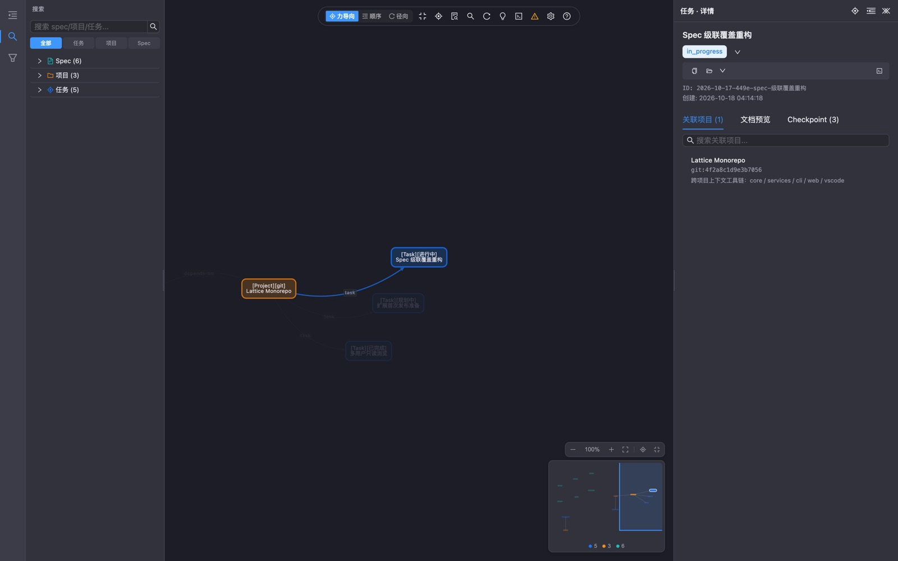

<p align="center">
  
</p>

<h1 align="center">Lattice</h1>

<p align="center">
  <b>Above the repo. Beyond the session.</b><br>
  Local-first engineering memory and workflow for AI-assisted development — specs, tasks, decisions and experience captured once in <code>~/.lattice</code>, reused across projects, sessions and agents.
</p>

<p align="center">
  <a href="https://www.npmjs.com/package/@qcqx/lattice-cli"></a>
  <a href="https://www.npmjs.com/package/@qcqx/lattice-core"></a>
  <a href="https://www.npmjs.com/package/@qcqx/lattice-web"></a>
  <a href="https://www.npmjs.com/package/@qcqx/lattice-cli"></a>
  <a href="./LICENSE"></a>
  <a href="https://github.com/qxchuckle/lattice/stargazers"></a>
  <a href="https://open-vsx.org/extension/qcqx/lattice-context"></a>
    <a href="https://marketplace.visualstudio.com/items?itemName=qcqx.lattice-context"></a>
</p>

<p align="center">
  <b>English</b> | <a href="./README.zh-CN.md">简体中文</a><br>
  <a href="https://lattice.qcqx.cn/">Website</a> ·
  <a href="https://lattice.qcqx.cn/demo/">Live demo</a> ·
  <a href="https://lattice.qcqx.cn/docs/">Docs</a>
</p>

Lattice is a local-first **engineering memory and workflow layer**. It turns specs, tasks, decisions, project relations and experience — usually lost between repos, sessions and agents — into structured, searchable, versionable engineering assets, and serves them to people and AI through a CLI, an editor extension and a web workbench.

## Why Lattice

- **Entering an unfamiliar repo?** Get its conventions, active tasks and relations before writing a line of code.
- **Working across projects?** Keep specs, tasks, decisions and experience in one place instead of one copy per repo.
- **Solved something similar before?** Search past specs, decisions and experience instead of starting from scratch.
- **Using AI agents?** Inject a workflow, not just context: read memory at start, record while working, distill when archiving.

## Screenshots

| Web workbench | Task detail |
|---|---|
|  |  |
|  |  |

*The web workbench — also embedded inside the VS Code extension ("Lattice: Open Web Workbench").*

## Core capabilities

| Capability | Description |
|---|---|
| **Layered specs** | Global / user / project specs with automatic cascade override (ancestors included) |
| **Tasks & checkpoints** | Full lifecycle (planning → in progress → done → archived) with typed checkpoints (11 types) recording context, decisions, pivots, milestones |
| **Project registry** | Fingerprint-based project identity, monorepo nesting, cross-repo relations, alias-aware virtual merge |
| **RAG search** | Local embeddings + full-text index across specs, tasks, checkpoints and docs |
| **Memory aggregation** | `ltc context` assembles the specs, active tasks, related projects and relevant memory for the current repo in one shot |
| **Dual-track sync** | `origin` — single-repo multi-machine full sync; domains (experience packs) — multi-user collaboration over Git remotes, merged read-time |
| **Spec templates** | Built-in + remote template registry for project conventions |
| **Workflow injection** | `ltc init` injects the Lattice workflow into Cursor / Claude Code / Qoder / Trae — read memory at start, record while working, distill when archiving |
| **VS Code extension** | Native sidebar views, graph workbench webview, Problems diagnostics, multi-user, checkpoint drafting — running the core **in-process** |
| **Web workbench** | `ltc web` (or the extension's built-in workbench) — task / project / spec explorer and Cytoscape knowledge graph |

## Three ways to use it

| | CLI | VS Code extension | Web workbench |
|---|---|---|---|
| **For** | Automation, scripts, AI agents | Day-to-day browsing and editing | Visual exploration |
| **Install** | `npm i -g @qcqx/lattice-cli` | [Open VSX](https://open-vsx.org/extension/qcqx/lattice-context) · [VS Marketplace](https://marketplace.visualstudio.com/items?itemName=qcqx.lattice-context) | `npm i -g @qcqx/lattice-web` |
| **Run** | `ltc init` · `ltc scan` · `ltc context` | Activity bar → Lattice (first run: **Quick Start** — no CLI needed) | `ltc web` → browser, or the extension's built-in webview |
| **Docs** | [packages/cli](./packages/cli/README.md) | [packages/vscode](./packages/vscode/README.md) | [packages/web](./packages/web/README.md) |

## Packages

| Package | Role | Version |
|---|---|---|
| [`@qcqx/lattice-core`](./packages/core) | Domain core: storage, spec cascade, RAG, sync | [](https://www.npmjs.com/package/@qcqx/lattice-core) |
| [`@qcqx/lattice-protocol`](./packages/protocol) | Cross-host contracts (types-only DTOs & messages) | [](https://www.npmjs.com/package/@qcqx/lattice-protocol) |
| [`@qcqx/lattice-services`](./packages/services) | Use-case layer shared by CLI / web / extension | [](https://www.npmjs.com/package/@qcqx/lattice-services) |
| [`@qcqx/lattice-cli`](./packages/cli) | Command line (`lattice` / `ltc`) | [](https://www.npmjs.com/package/@qcqx/lattice-cli) |
| [`@qcqx/lattice-web`](./packages/web) | Web server (HTTP API + static assets) | [](https://www.npmjs.com/package/@qcqx/lattice-web) |
| [`@qcqx/lattice-web-ui`](./packages/web-ui) | Shared React UI (web client & extension webview) | [](https://www.npmjs.com/package/@qcqx/lattice-web-ui) |
| [`lattice` (VS Code)](./packages/vscode) | VS Code extension (in-process core + webview) | 0.1.1 (VSIX) |

## Quick start

```bash
# CLI — installs `lattice` and `ltc`
npm install -g @qcqx/lattice-cli
ltc init          # create ~/.lattice, pick a username, inject the Lattice workflow
ltc scan          # register local projects (or `ltc link` inside a non-git repo)
ltc context       # every spec / active task / related project for the current repo
```

```bash
# Development + packaging of the VS Code extension
pnpm install
pnpm package:vscode   # → packages/vscode/dist-vsix/lattice-context-<version>.vsix
```

```bash
# Web workbench
npm install -g @qcqx/lattice-web
ltc web               # opens the local web UI
```

## Data & privacy

- Everything lives in `~/.lattice` on your machine — projects, specs, tasks, checkpoints, the search index.
- No telemetry, no network calls from the tooling itself. Sync (origin / domains) only touches the Git remotes **you** configure.
- The VS Code extension reads and writes the same data root **in-process** (no CLI subprocess, no local HTTP server required).

## Documentation

- [Quick start](./docs/quick-start.md)
- [Architecture](./docs/architecture.md)
- [Directory & configuration](./docs/directory-and-config.md)
- [Spec template registry](./docs/spec-template-registry.md)
- [Docs index](./docs/README.md)

Package docs: [cli](./packages/cli/README.md) · [core](./packages/core/README.md) · [web](./packages/web/README.md) · [vscode](./packages/vscode/README.md)

### AI / agent workflow templates

- [Skills overview](./packages/core/public/templates/skills/en/SKILL.md)
- [Always-on rules (hard constraints)](./packages/core/public/templates/platforms/en/lattice-rules.md)
- [CLI command reference](./packages/core/public/templates/skills/en/command-reference.md)
- [Task workflows](./packages/core/public/templates/skills/en/task-workflows.md) · [Spec workflows](./packages/core/public/templates/skills/en/spec-workflows.md)
- [Project context](./packages/core/public/templates/skills/en/project-context.md) · [Project discovery](./packages/core/public/templates/skills/en/project-discovery.md)
- [Agent commands](./packages/core/public/templates/skills/en/agent-commands.md)

## Repository structure

```
packages/
├── core/       → @qcqx/lattice-core       domain core (storage, cascade, RAG, sync)
├── protocol/   → @qcqx/lattice-protocol   cross-host contracts (types-only)
├── services/   → @qcqx/lattice-services   use cases shared by all hosts
├── cli/        → @qcqx/lattice-cli        command line (lattice / ltc)
├── web/        → @qcqx/lattice-web        web server + client bundle
├── web-ui/     → @qcqx/lattice-web-ui     shared React UI components
└── vscode/     → lattice (VS Code)        extension: views, webview, diagnostics
```

## Contributing

Issues and PRs are welcome — see [CONTRIBUTING.md](./CONTRIBUTING.md). Please follow the [Code of Conduct](./CODE_OF_CONDUCT.md);
for security reports use [SECURITY.md](./SECURITY.md).

## License

[MIT](./LICENSE)

<!-- Star history — uncomment once the star count is meaningful:
<p align="center">
  <a href="https://star-history.com/#qxchuckle/lattice&Date"></a>
</p>
-->
