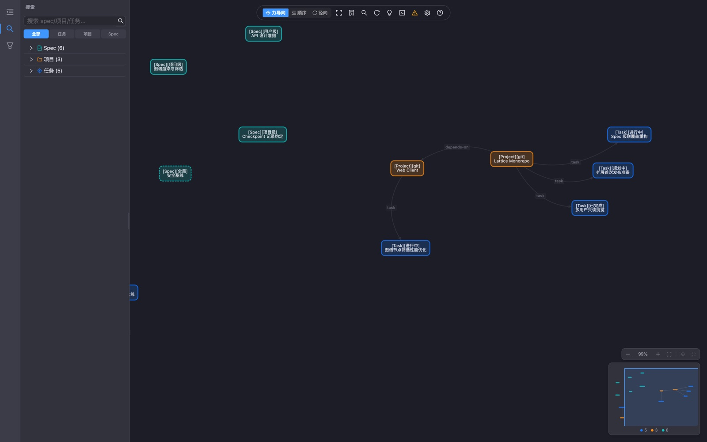
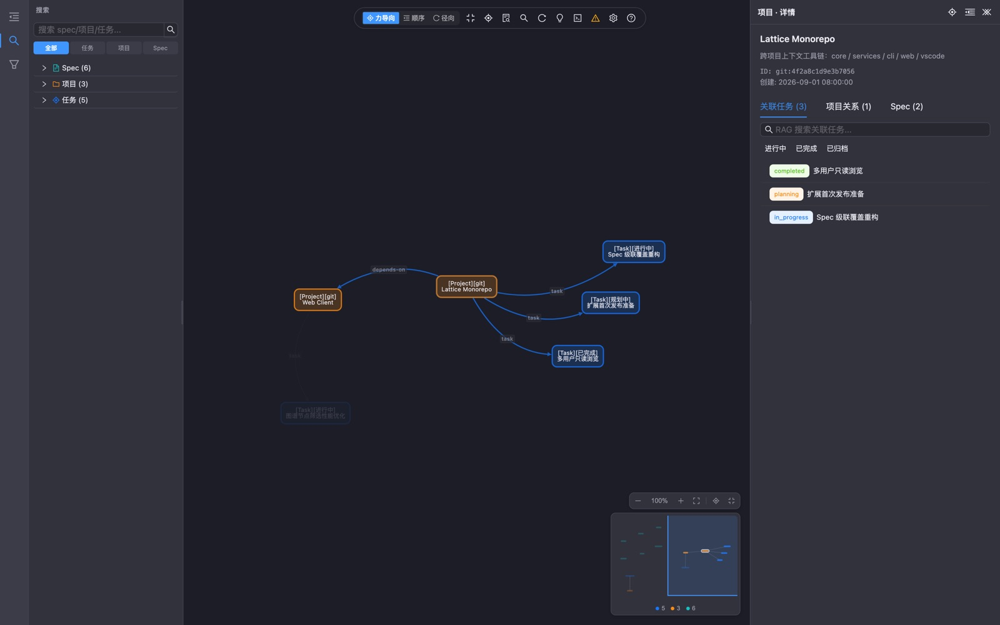
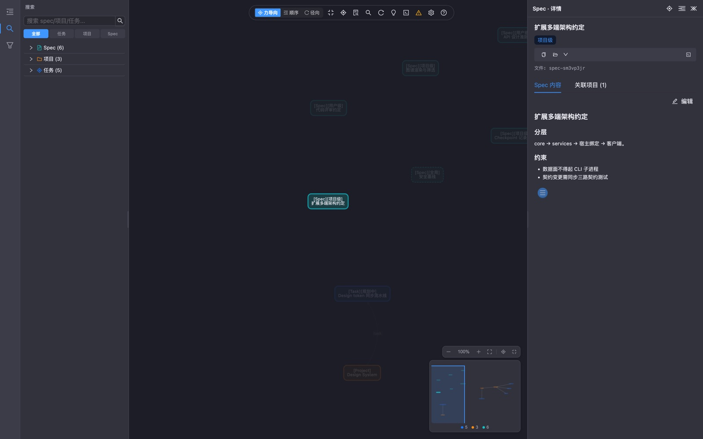

# Lattice — Engineering Memory & Workflow

Bring [Lattice](https://github.com/qxchuckle/lattice)'s engineering memory into your editor: specs, tasks with PRD / design / progress, decisions, RAG-powered search, a knowledge graph, and one-click maintenance of the metadata your AI assistants rely on.

> 中文说明见 [README.zh-CN.md](./README.zh-CN.md)。

## Screenshots

| Workbench (webview) | Task detail |
|---|---|
|  |  |
|  |  |

*The graph workbench webview runs the Lattice web UI in-process — no external server required.*

## Requirements

- VS Code `^1.85.0` (also works in VS Code forks: Cursor, Qoder, VSCodium — via Open VSX).
- A Lattice data home (`~/.lattice`). If you have used the Lattice CLI or web client before, you already have one — the extension needs nothing else. If you don't, run **Lattice: Quick Start** — it bootstraps one in-process (no CLI required).
- **The data plane is in-process.** The extension reads and writes your Lattice home directly (Electron's built-in SQLite with FTS5, plus file sources as fallback). No HTTP, no bundled native binaries, no CLI process per view.
- The `ltc` CLI is **optional**: full initialization (`ltc init`: AI-client injection, git, templates) still runs in a terminal, but project scanning, current-project registration, configuration editing, users, sync domains, Git operations and maintenance are available in the in-editor **Lattice Configuration Center**. Install with `npm i -g @qcqx/lattice-cli` only if you want the full CLI setup.

## Features

### Sidebar views

- **Active project** — resolves the nearest project root for the active file: multi-root workspaces, monorepos, nested Git repositories and nested `lattice.json` are supported. Pin a project from the status bar or **Switch Active Project**; tasks, specs, task creation, project commands and the Configuration Center share the same context.
- **Tasks** — status groups with pinned active tasks for the current project; expandable PRD / design / progress (recent checkpoints, full read-only log tab), referenced specs, subtasks, associated projects. Multi-select batch actions (start / complete / archive / copy IDs); detach associated projects, remove / clear scope paths (confirmation required), change the parent task. Drag & drop: drop a task on a project to associate it, drop a spec on a task to reference it. **Live-preview search** (results as you type: instant local matches plus debounced full-text hits) and status × project quick filter, with a visible filter line; one-click **clear buttons** appear in the view title while a search or filter is active, and both survive window reloads. **Task grouping**: switch between status and time (**by creation / last updated**, with any **year / month / day** level combination) from the view title. "Reveal in Sidebar" from every task, spec, project, search result and detail panel.
- **Specs** — project (grouped by project) / user / global scopes, conflict groups, "referenced by" expansion. **New Spec wizard** (blank or template; scope picker: user / **project — with a searchable project picker, no active project required** / global; path traversal is rejected; also reachable by right-clicking a project group, the User / Global section or the Project section root in the tree) and an **Edit Spec Metadata** wizard (title / description / tags). **Spec health check**: lint issues and name conflicts are published to the Problems panel and refreshed on save. Keyword search matches titles, descriptions, tags and spec content; layer × project filter.
- **Projects** — pinned current project, relations with descriptions, project-level specs, profile. **Multi-level grouping**: the title-bar **Grouping** button switches between flat and a nested group tree (`工作/前端/组件库`) with per-group project counts and an **Ungrouped** node; group nodes support new sub-group / rename / move / remove (whole sub-tree, impact confirmation) / copy path, and projects support **Add to Groups…** (multi-select, missing paths auto-created). Context menu: open in file manager / current window / new window / terminal, rename, edit description, edit metadata (groups & tags included); groups × tags filter with **sub-tree matching** (tooltips surface groups / tags). Keyword search across names, ids and paths.
- **Detail view** — a sidebar panel that follows your selection (task / spec / project) and defaults to the active task: title, status, projects, docs, checkpoints and spec refs without opening the graph panel.
- **Search** — live-preview QuickPick (results while you type; Enter applies the query, clicking a result applies and reveals it); results persist as a view (query + up to 100 results survive reloads); **search history** (focus the empty input to see recent queries, clearable); `#task` / `#spec` / `#project` / `#checkpoint` / `#relation` prefix filters; weak-match hints; inline *Show in Graph* / *Copy ID* buttons; type × project filter and title-bar clear.
- **Configuration & Maintenance** — a fixed Lattice-sidebar entry for the Configuration Center: open the overview, scan/register projects, register the active project, switch the active project, users & sync, diagnostics, editor settings or Lattice config in one click. The view title also exposes gear / scan / register / native-settings shortcuts.

### QuickPick modifier keys (task / project / spec pickers)

- `Cmd+Enter` (`Ctrl+Enter` on Windows/Linux) — copy the highlighted item's ID
- `Alt+Enter` — open the item in the graph workbench
- `Ctrl+Enter` on macOS (`Ctrl+Shift+Enter` elsewhere) — reveal in the sidebar

### Task workflows (all in-process, native wizards)

Create & start, complete, archive, reopen, delete with a "Restore" toast (recycle bin), **checkpoint wizard (11 types)** plus **long-text checkpoint drafts** (an untitled Markdown document; committing writes it straight into `progress.yaml`), **Summarize Task** (a draft pre-filled with done / pending / next sections and the latest checkpoints), associate the active project / files & folders, reference specs, rename, copy ID, **copy task context as Markdown for AI prompts**, batch operations on multi-selection.

### Graph workbench (`Cmd/Ctrl+Shift+G`)

Webview reusing the Lattice web client's Cytoscape canvas: global / task / project / spec anchors, node & edge filters, force / sequential / radial layouts, minimap, legend, read-only detail panel — **including Git status for projects** (branch, dirty count, ahead/behind, last commit) when the project has a local repository. Theme follows VS Code; `lattice.graph.keepContext` keeps the panel state alive while hidden.

### Editor integrations

- `spec-xxxxxxxx` tokens in Markdown / YAML / text become **clickable links** to the spec document.
- `lattice.json` gets a **CodeLens** with the project identity (or a `ltc link` hint when unregistered).
- Files inside the **active task's scope paths** get a `T` badge; Explorer context menu: *Add to task scope*.
- Spec lint & conflict diagnostics land in the **Problems** panel.

### Multi-user

- The status bar shows the current user; click it to switch, create or rename users.
- **Read-only browsing**: inspect another user's tasks, projects, specs — and even the graph. Every write is blocked at the data plane and by command-level guards.

### Configuration Center

Open **Lattice: Open Configuration Center** (editor-area WebviewPanel, singleton; also in every view title bar and the project status menu) to manage the whole installation without leaving the editor:

- **Overview** — data root, user, versions, project / task / spec / relation counts, database and watcher health, RAG status, Git state and sync-domain summary.
- **Projects & registration** — current workspace / multi-root / monorepo project candidates (registered via `lattice.json`, registered via Git fingerprint, unregistered, nested). Each workspace folder lists its root project plus registered nested projects, with register / set-active / open-folder / edit-metadata actions. Registration defaults to **not writing** `lattice.json` (Git fingerprint only); scan directories default to the current workspace, with progress / cancel and a searchable project table.
- **Editor settings** — all `lattice.*` settings grouped, with defaults, source scope, reset and "open native settings".
- **Lattice config** — global `config.json` and local `config-local.json`: RAG model presets, dimensions, prefixes, download options, templates, scan directories, language, data-repo Git remote. Model changes prompt for an index rebuild.
- **Users & sync** — switch / create / rename users; add, edit, reorder, unlink and sync knowledge-pack domains; Git status with commit / pull / push / sync and remote management.
- **Diagnostics** — full RAG details, update / rebuild, doctor health check (with fix), snapshot errors, diagnostics copy, logs, data folder and config files.
- **Advanced** — raw JSON view (form saves preserve unknown keys) and config-file shortcuts.

All writes go through the extension host and core/services; the webview has no network access (`connect-src 'none'`). High-risk changes (data root, model, user, sync domain removal) are confirmed. No project/user deletion, and no web-password editing in the extension.

### Maintenance & onboarding

RAG status / incremental update / rebuild (cancellable, progress in the notification), doctor health check (with fix), recycle bin browser (restore / purge), **Open Web Workbench** (opens the in-editor web workbench — the built-in webview running the same UI as the graph panel; no external server needed), diagnostics copy, and a "Get Started with Lattice" walkthrough with per-view welcome states.

### i18n

The UI follows your editor's display language (English and Simplified Chinese bundles included).

## Commands & Settings

All commands live under the **Lattice** category in the Command Palette (type `Lattice:`). Handy defaults:

| Command | Keybinding |
|---|---|
| Lattice: Search Lattice… | `Cmd/Ctrl+Shift+L` |
| Lattice: Open Graph | `Cmd/Ctrl+Shift+G` |
| Lattice: Open Configuration Center | sidebar **Configuration & Maintenance** / view title gear / project status menu |
| Lattice: Register This Project | command palette / welcome |
| Lattice: Manage Users… | status bar user item |
| Task / spec / project / batch actions | context menus on tree items |

Key settings (see *Settings → Lattice* for all):

| Setting | Default | Purpose |
|---|---|---|
| `lattice.latticeHome` | `""` | Override the data directory (= `LATTICE_HOME`) |
| `lattice.autoRefresh` | `true` | Watch `~/.lattice` and refresh views |
| `lattice.tasks.scope` | `all` | Task view scope: all projects / current project |
| `lattice.tasks.showArchived` | `true` | Show the archived group in the task tree |
| `lattice.statusBar.user` / `.project` / `.activeTasks` | `true` | Status bar items |
| `lattice.specDiagnostics.enabled` | `true` | Spec lint / conflicts in the Problems panel |
| `lattice.graph.defaultLayout` | `force` | Default graph layout |
| `lattice.graph.keepContext` | `false` | Keep the graph panel's state while hidden |
| `lattice.editor.specLinks` | `true` | Clickable `spec-*` links |
| `lattice.decorations.enabled` | `true` | Active-task scope file badges |
| `lattice.documents.ragHintOnSave` | `true` | Offer spec migrate + RAG update after saving a spec |

## Getting started

1. Make sure you have a Lattice home: run **Lattice: Quick Start** (in-process — creates the home and registers your workspace; no CLI required), or use the walkthrough's full `ltc init` for AI-client injection and more.
2. Open a repository and run **Lattice: Register Current Project…** (or **Lattice: Open Configuration Center** → Projects). Git repositories register by fingerprint without writing files; non-Git folders require an explicit `lattice.json` anchor.
3. Click the **Lattice** icon in the Activity Bar. Use the gear icon or project status menu to open the Configuration Center at any time.

## Privacy

- No telemetry. No network requests from the extension or its webviews (the graph webview runs under `connect-src 'none'`).
- Data access is in-process: the extension reads your Lattice home directly and writes through the same core the CLI and web client use. Nothing leaves your machine.

## Development

See the monorepo root. Quick reference:

```bash
pnpm build:vscode     # webview bundle (vite) + extension bundle (tsup)
pnpm package:vscode   # produce dist-vsix/lattice-context-<version>.vsix
pnpm --filter lattice-context test             # unit tests (node --test)
pnpm --filter lattice-context test:integration # @vscode/test-cli (in-process core fixture)
```

Press <kbd>F5</kbd> in VS Code (with this folder open) to launch the Extension Development Host.

## Publishing

Open VSX and the Microsoft Marketplace are both supported; tokens are provided by the maintainer at publish time:

```bash
pnpm --filter lattice-context run release                                  # build + package + sha256
pnpm dlx ovsx publish dist-vsix/lattice-context-<version>.vsix -p <TOKEN>  # Open VSX
pnpm exec vsce publish --packagePath dist-vsix/lattice-context-<version>.vsix -p <PAT>  # Marketplace
```

## License

[MIT](./LICENSE)
